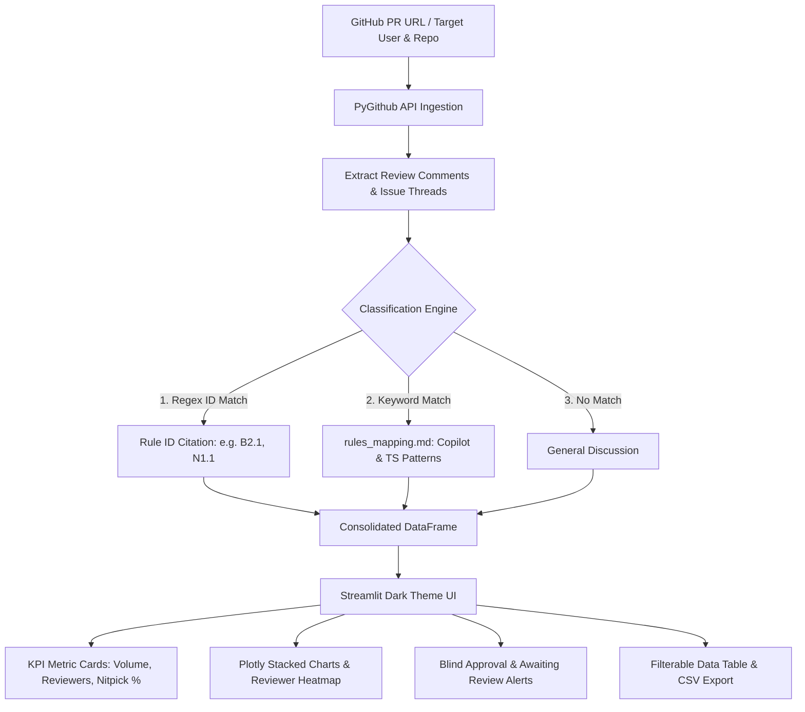

# 🔍 PR Comment Analyzer by Tejas P

[](https://python.org)
[](https://streamlit.io)
[](https://plotly.com)
[](https://github.com/PyGithub/PyGithub)
[](https://www.typescriptlang.org/)

An automated engineering quality dashboard and code review audit tool designed for engineering leads, tech leads, and managers.

It audits Pull Request reviews by extracting feedback, evaluating reviewer thoroughness, detecting rubber-stamping (blind approvals), calculating nitpick-to-value ratios, and automatically classifying review comments—including **human reviewer remarks** and **GitHub Copilot / AI review agent comments** across frontend and backend TypeScript codebases.

---

## 📑 Table of Contents

- [Key Value & Capabilities](#-key-value--capabilities)
- [Architecture & Workflow](#-architecture--workflow)
- [Project Structure](#-project-structure)
- [Prerequisites](#-prerequisites)
- [Quickstart & Installation](#-quickstart--installation)
- [GitHub Authentication & Token Setup](#-github-authentication--token-setup)
- [Classification Engine](#-classification-engine)
  - [Tier 1: Explicit Rule ID Citations](#tier-1-explicit-rule-id-citations)
  - [Tier 2: Copilot & Technical Keyword Matching](#tier-2-copilot--technical-keyword-matching)
  - [Supported Categories Overview](#supported-categories-overview)
- [Dashboard Walkthrough](#-dashboard-walkthrough)
  - [Tab 1: Single PR Audit](#tab-1-single-pr-audit)
  - [Tab 2: User PR Comparison](#tab-2-user-pr-comparison)
- [Extending & Customizing Rules](#-extending--customizing-rules)
- [Troubleshooting & FAQs](#-troubleshooting--faqs)

---

## 🌟 Key Value & Capabilities

- **Automated Review Categorization**: Maps comments into 16 canonical engineering categories (`A. Architecture` through `P. Commits`) plus `Nitpick`.
- **GitHub Copilot & AI Review Support**: Built-in compound keyword dictionary mapping automated GitHub Copilot suggestions and AI reviewer findings across fullstack TypeScript (React / Next.js frontend and Node.js / Express / NestJS backend).
- **Nitpick Ratio Metric**: Quantifies bikeshedding (e.g., formatting, typos, semicolons) vs. high-leverage feedback (architecture, type safety, performance, security).
- **Rubber-Stamp & Blind Approval Detection**: Identifies closed or merged PRs that had zero technical comments, flagging review gaps before they cause production regressions.
- **Awaiting Review Tracking**: Lists open PRs currently blocked without review comments.
- **Reviewer Participation Matrix**: Visualizes peer-review heatmaps to understand cross-team collaboration dynamics.
- **Exportable Audit Reports**: One-click download of all categorized comments with source code paths and direct GitHub URLs as CSV.

---

## 🏛 Architecture & Workflow



---

## 📂 Project Structure

```
pr-comment-analyzer/
├── app.py                  # Streamlit dashboard & PR classification logic
├── requirements.txt        # Python dependency manifest
├── rules_mapping.md        # Compound keyword rules for human & Copilot comments
├── rules/
│   └── rules.md            # Canonical engineering standards catalog & review checklist
├── .env.example            # Template for GitHub PAT configuration
├── .gitignore              # Git ignore rules (secrets, virtualenvs, cache)
└── README.md               # Project documentation
```

---

## 📋 Prerequisites

- **Python**: Version `3.10` or higher (`python --version`)
- **GitHub Account**: With access to the target repositories
- **GitHub Personal Access Token (PAT)**: Classic or fine-grained token with repository read permissions

---

## 🚀 Quickstart & Installation

### 1. Clone the Repository

```bash
git clone https://github.com/BinariedUs/pr-comment-analyzer.git
cd pr-comment-analyzer
```

### 2. Set Up a Virtual Environment

**On macOS / Linux:**

```bash
python3 -m venv venv
source venv/bin/activate
```

**On Windows (PowerShell):**

```powershell
python -m venv venv
.\venv\Scripts\Activate.ps1
```

### 3. Install Dependencies

```bash
pip install -r requirements.txt
```

### 4. Configure Authentication

Create a `.env` file by copying `.env.example`:

```bash
cp .env.example .env
```

Edit `.env` and add your GitHub token:

```env
GITHUB_TOKEN=ghp_yourPersonalAccessTokenHere
```

> [!NOTE]
> You can also supply your token directly in the application's sidebar UI at runtime. The UI input takes priority over `.env`.

### 5. Launch the Application

```bash
streamlit run app.py
```

The app will open automatically in your browser at `http://localhost:8501`.

---

## 🔑 GitHub Authentication & Token Setup

To inspect private repositories or avoid strict unauthenticated API rate limits, provide a GitHub Personal Access Token:

1. Go to **GitHub Settings** → **Developer Settings** → **Personal access tokens** → **Tokens (classic)**.
2. Click **Generate new token (classic)**.
3. Select the required scopes:
   - For **Private Repositories**: Select `repo` (Full control of private repositories).
   - For **Public Repositories only**: Select `public_repo` or leave scopes empty for read-only metadata.
4. Copy the token and paste it into `.env` or the sidebar input field in the Streamlit app.

---

## 🧠 Classification Engine

The analyzer processes review feedback through an intelligent two-tier pipeline:

### Tier 1: Explicit Rule ID Citations

If a team member cites an explicit rule ID from [`rules/rules.md`](file:///d:/Workspace/pr-comment-analyzer/rules/rules.md) (e.g. `B1.1`, `D2.3`, `M1.2`, `N1.1`), the engine automatically routes the comment to its exact category:

```markdown
> "Violates B2.1 — avoid using any without a runtime guard."
> → Category: B. TypeScript | Trigger: Explicit Citation: B2.1
```

### Tier 2: Copilot & Technical Keyword Matching

When comments do not contain formal citations (standard review remarks or automated GitHub Copilot findings), the engine falls back to matching compound technical keywords defined in [`rules_mapping.md`](file:///d:/Workspace/pr-comment-analyzer/rules_mapping.md).

#### Supported TypeScript Ecosystems:

- **Frontend (React, Next.js, Vite)**: Hooks dependencies, state derivations, re-renders, prop-drilling, JSX branching, Tailwind/CSS styling, XSS sanitization.
- **Backend (Node.js, Express, NestJS, Fastify, Prisma, TypeORM)**: Unhandled promise rejections, DTO/payload validations (Zod, Joi), SQL injection, N+1 database queries, HTTP status conventions, authentication/CORS middleware, connection leaks.

### Supported Categories Overview

| Code  | Category           | Focus Areas & Copilot Keywords                                                                                             |
| :---- | :----------------- | :------------------------------------------------------------------------------------------------------------------------- |
| **A** | **Architecture**   | Feature modules, boundaries, controller/service layers, repository patterns, dependency injection                          |
| **B** | **TypeScript**     | Type safety, `as any`, type narrowing, type guards, optional chaining `?.`, nullish coalescing `??`, explicit return types |
| **C** | **Naming**         | `kebab-case`, `PascalCase`, `camelCase`, `is/has/should` boolean prefixes, vague variable names                            |
| **D** | **Constants**      | Hardcoded strings/numbers, `as const` objects, literal unions, domain constants                                            |
| **E** | **UI Reuse**       | Primitive component reuse (`ui-components/`), avoiding local duplicates, button `type="button"`                            |
| **F** | **Styling**        | Module styles (`styles.ts`), theme tokens, sx props, dynamic Tailwind patterns, hardcoded hex values                       |
| **G** | **API Layer**      | Shared axios instance, unwrapped payloads, DTOs, Zod schemas, HTTP status codes (`201`, `400`, `404`), pagination          |
| **H** | **JSX Logic**      | Avoiding nested ternaries in JSX, conditional rendering helpers, early returns                                             |
| **I** | **Code Quality**   | Cognitive complexity, DRY violations, dead code, premature abstractions, narrating comments, unlinked TODOs                |
| **J** | **Utilities**      | Shared helper functions, `date-fns` over `moment`, date formatting utilities                                               |
| **K** | **Imports**        | Import group ordering, removing unused imports, circular imports, barrel exports                                           |
| **L** | **Error Handling** | Try-catch blocks, unhandled promise rejections, error middleware `next(err)`, logger vs `console.log`                      |
| **M** | **Performance**    | `useMemo`, `useCallback`, `useEffect` dependency arrays (`exhaustive-deps`), N+1 queries, memory leaks, caching            |
| **N** | **Security**       | Sanitization (`DOMPurify`), SQL injection, CSRF, CORS, hardcoded secrets, `process.env` leakage, PII                       |
| **O** | **Testing**        | Unit tests, integration tests, mock implementations, edge cases, test coverage                                             |
| **P** | **Commits**        | Conventional Commits, commitlint, lint-staged, bypassing git hooks                                                         |
| **-** | **Nitpick**        | Minor styling, typos, spelling, indentation, whitespace, semicolons, trailing commas                                       |

---

## 🖥 Dashboard Walkthrough

### Tab 1: Single PR Audit

Audit feedback quality on any individual Pull Request URL.

1. Paste a Pull Request URL (e.g. `https://github.com/organization/repo/pull/42`).
2. Click **Run Single Analysis**.
3. **Key Metrics Displayed**:
   - **Total Feedback**: Count of all top-level review comments.
   - **Reviewers**: Unique participants who contributed feedback.
   - **Primary Category**: Dominant pattern violated.
   - **Nitpick Ratio**: Percentage of comments flagged as trivial nitpicks vs. high-leverage engineering feedback.
4. **Visualizations**:
   - Reviewer activity bar chart.
   - Categorized impact distribution.
5. **Detailed Table & Export**:
   - Filter and inspect comments with the exact violating file and rule trigger.
   - Click **Download Analysis Report (CSV)** for archiving or discussion in 1-on-1s.

---

### Tab 2: User PR Comparison

Evaluate code quality trends across multiple Pull Requests authored by a developer over a given timeframe.

1. Enter the **Target GitHub Username** and **Target Repository** (e.g. `org/repo`).
2. Select the **Start Date (Since)** filter.
3. Click **Run User Comparison**.
4. **Aggregated Insights**:
   - **Total PRs Evaluated**: Number of recent PRs checked (up to 15 per run).
   - **PRs w/ Feedback**: PRs that received technical code review.
   - **Zero-Comment PRs**: Tracks both **Blind Approvals** (merged PRs with 0 comments) and **Awaiting Review** (open PRs pending review).
   - **Average Feedback per PR**: Feedback density on reviewed pull requests.
5. **Interactive Visualizations**:
   - **Stacked Bar Chart**: Comment categories across PR numbers.
   - **Reviewer Participation Heatmap**: Frequency matrix showing who reviewed each PR.
6. **Download Comparison Report (CSV)**: Aggregated multi-PR audit dataset.

---

## 🛠 Extending & Customizing Rules

### Adding New Keywords to `rules_mapping.md`

Open [`rules_mapping.md`](file:///d:/Workspace/pr-comment-analyzer/rules_mapping.md) and add comma-separated terms to any existing category:

```markdown
[B. TypeScript]: your_new_keyword, custom_type_guard, zod_infer
[G. API Layer]: trpc, fastify_schema, openapi_spec
```

The parser automatically lowercases and trims entries, and deduplicates matching expressions on startup.

### Customizing Team Engineering Standards

The full engineering standard document is located in [`rules/rules.md`](file:///d:/Workspace/pr-comment-analyzer/rules/rules.md). You can update this file to reflect your engineering organization's coding conventions, forbidden libraries, architectural boundaries, and naming guidelines.

---

## ❓ Troubleshooting & FAQs

### 1. `404 Not Found` or `Resource not accessible by integration`

- Ensure your GitHub Personal Access Token has access to the target repository.
- For private repositories or GitHub Enterprise, ensure the `repo` scope is checked.
- Verify that the repository name and PR number in the URL are correct.

### 2. GitHub API Rate Limits

- Unauthenticated requests are limited to 60 requests per hour.
- Authenticated requests with a PAT enjoy up to **5,000 requests per hour**. Always configure a token when auditing active repositories.

### 3. Comments categorized under "General Discussion"

- Comments that are purely conversational (e.g., _"LGTM!"_, _"Thanks for addressing this"_) or do not contain mapped keywords default to `General Discussion`.
- To categorize recurring technical phrases, add them to [`rules_mapping.md`](file:///d:/Workspace/pr-comment-analyzer/rules_mapping.md).

---

## 📄 License

Internal tool developed by Tejas P. Distributed under the MIT License.
